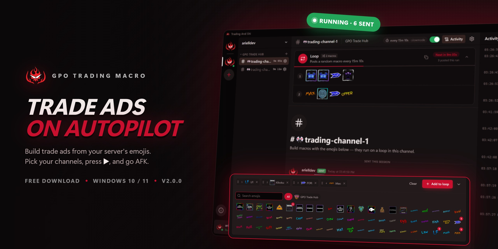

<p align="center">
  
</p>

<p align="center">
  <a href="https://github.com/arielldev/GPO-Trading-Macro-Discord/releases/latest"></a>
  <a href="https://discord.gg/unPZxXAtfb"></a>
</p>

<p align="center"><b>Build trade ads from your server's emojis. Pick your channels, press ▶, and go AFK.</b></p>

> [!WARNING]
> **Use an alt account.** Automated posting breaks Discord's Terms of Service use this at your own risk.

## Download

Get the **`-setup.exe`** installer from the [latest release](https://github.com/arielldev/GPO-Trading-Macro-Discord/releases/latest). Windows 10 and 11, 64-bit.

Seeing "Windows protected your PC"? The app isn't code-signed yet. Click **More info → Run anyway**.

## How it works

1. **Add an account.** Click **+** and paste your token. A guided tour shows you where.
2. **Add channels.** Pick a server and channel. Its slowmode is detected and used as the cooldown.
3. **Build macros.** Click emojis to build a trade ad, then **Add to loop**.
4. **Press ▶.** Every channel posts on its own timer while you're AFK. Press **■** to stop.

## Features

|                          |                                                                        |
| ------------------------ | ---------------------------------------------------------------------- |
| 🔁 **Loops**             | Each channel cycles its macros at random                               |
| 🐢 **Slowmode-aware**    | Cooldowns follow each channel's slowmode automatically                 |
| 😀 **Emoji library**     | Pull every emoji from a server in one click, and sync when they change |
| 🩺 **Pre-start checks**  | Fixes renamed, re-uploaded and deleted emojis before every run         |
| 📋 **Copy and paste**    | Move loops or single macros between channels and accounts              |
| ⏱️ **Timing and safety** | Random delays, breaks and an auto-stop timer                           |
| 🕶️ **Anonymous mode**    | Hides names, avatars and times, for screenshots and streaming          |
| 🪶 **Minimal mode**      | Less RAM, CPU and data, with the same posts                            |
| 👥 **Multi-account**     | Run several accounts side by side                                      |

Your token and settings never leave your computer. They're stored in `%APPDATA%\com.arielldev.tradingandshi\config.json`.

## Troubleshooting

- **"Invalid or expired token".** Get a fresh token; the app shows how under **How do I get my token?**
- **Messages not sending.** Check that the account can post in that channel, and look at **Activity** for the exact error.
- **Rate limited.** The app waits it out and retries on its own.

## Build from source

Needs [Node.js](https://nodejs.org) 20+, [Rust](https://rustup.rs) and the [Tauri prerequisites](https://tauri.app/start/prerequisites/).

```bash
npm install
npm run tauri dev     # run locally
npm run tauri build   # installers in src-tauri/target/release/bundle/
```

## Support the project

- ⭐ **Star the repo.** It's free, takes one click, and helps more people find it.
- 💬 **[Join the Discord](https://discord.gg/unPZxXAtfb)** for help, updates and more macros.
